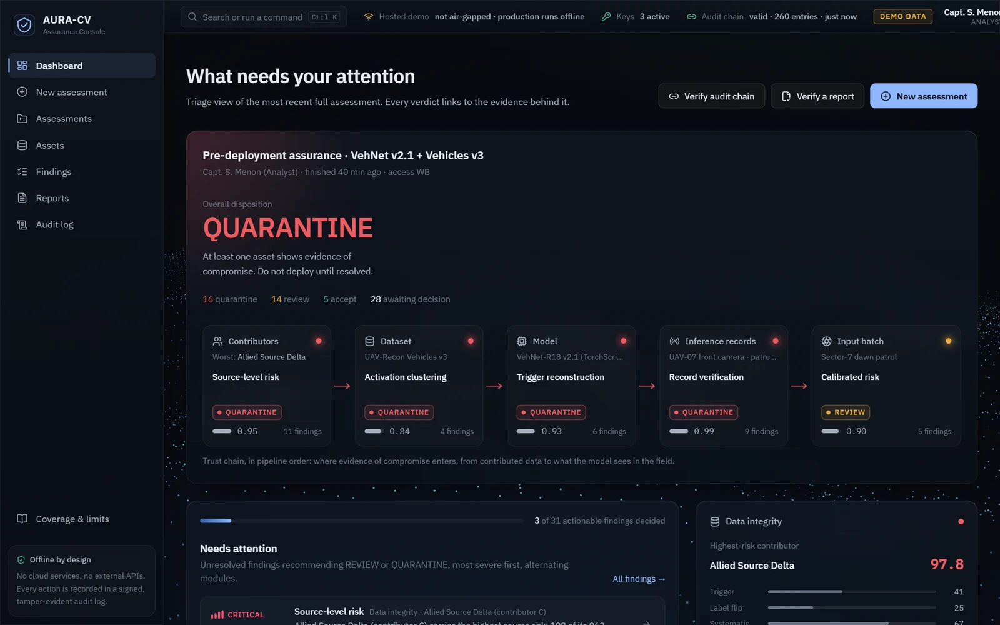
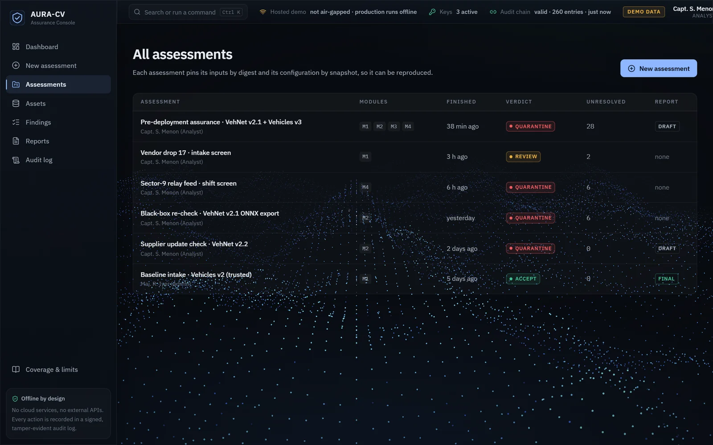
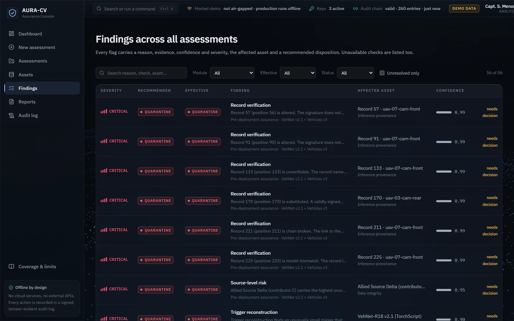
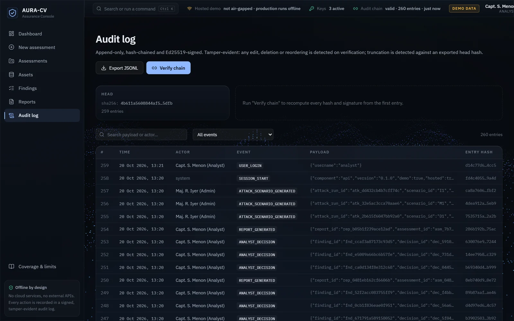
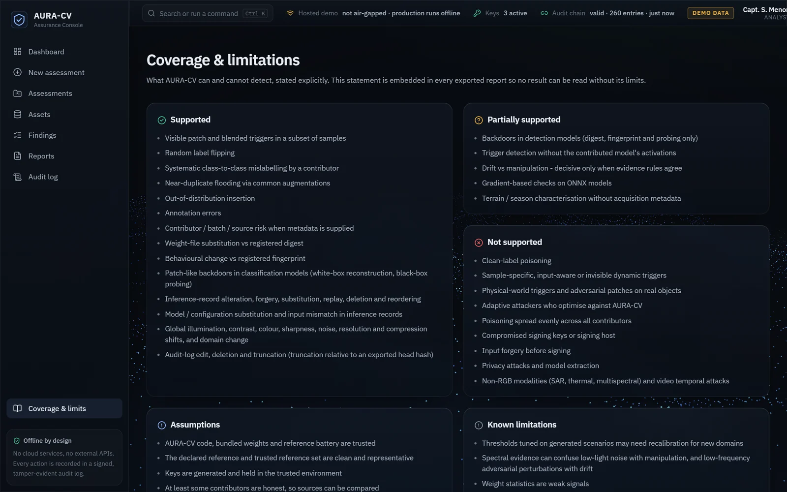
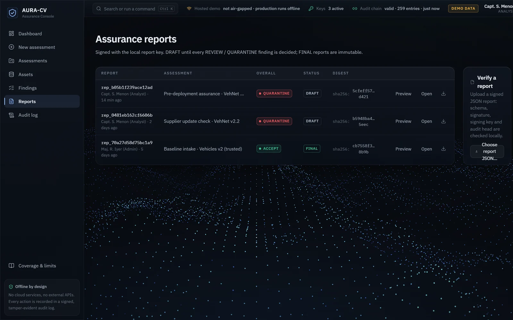
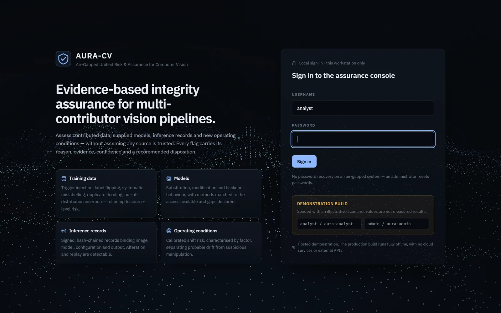

<div align="center">

# AURA-CV

**Air-Gapped Unified Risk & Assurance for Computer Vision**

An offline, model-agnostic framework that checks whether a contributed dataset, a trained model and its inference records can be trusted, and backs every verdict with signed evidence.

[Live demo](https://aura-cv-phi.vercel.app) · Smart India Hackathon, Ministry of Defence problem statement



</div>

## The problem

Ministry of Defence problem statement: *Trustworthy Computer Vision Integrity Assurance for Data, Models and Inference Outputs in Multi-Contributor Pipelines.*

When many contributors supply training data, models and inference logs, no single source can be trusted. Data can be poisoned with triggers or flipped labels, a weight file can be swapped, and inference records can be edited or replayed. AURA-CV evaluates each asset, records what it found, and recommends a disposition (accept, review or quarantine). The analysts using it are not ML experts and work in an air-gapped environment.

## Screens

The hosted demo signs in with `analyst / aura-analyst` (shown on the login page).

<table>
  <tr>
    <td width="50%"></td>
    <td width="50%"></td>
  </tr>
  <tr>
    <td><b>Assessments.</b> Each assessment pins its inputs by digest and its configuration by snapshot, so it can be reproduced.</td>
    <td><b>Findings.</b> Every flag has a reason, evidence, confidence, the affected asset and a recommended disposition.</td>
  </tr>
  <tr>
    <td></td>
    <td></td>
  </tr>
  <tr>
    <td><b>Audit log.</b> Append-only, hash-chained and Ed25519-signed. Editing, deleting or truncating an entry is detected on verification.</td>
    <td><b>Coverage &amp; limitations.</b> What AURA-CV can and cannot detect, stated plainly and embedded in every report.</td>
  </tr>
  <tr>
    <td></td>
    <td></td>
  </tr>
  <tr>
    <td><b>Reports.</b> Signed with the local report key. A report stays DRAFT until every REVIEW or QUARANTINE finding has a decision.</td>
    <td><b>Sign-in.</b> Local accounts only. There is no password recovery on an air-gapped system.</td>
  </tr>
</table>

## Status

This is an honest work in progress.

**Built (Milestone M0, foundations):**

- Domain model and finding schema (Pydantic v2, `schemas/finding.schema.json`)
- RFC 8785 canonical JSON and SHA-256 digests
- Ed25519 key store: generate, rotate, sign and verify, with key purposes
- Hash-chained, signed audit log and its verifier
- Disposition policy (effective, per-asset and overall verdicts)
- Check plugin framework, with `UNAVAILABLE` fallbacks when a check cannot run
- Outbound network guard and `aura selfcheck`
- The assurance console (React) and a demo API, deployable to Vercel

**Not built yet:** the detectors themselves (data poisoning, model backdoors, record tampering, distribution shift). The hosted console is seeded with illustrative scenario values, not measured results, and says so on the login screen. The milestone plan and requirement traceability are in [`docs/architecture.md`](docs/architecture.md).

## Architecture

```
   CLI (Typer)          API (FastAPI, 127.0.0.1)          UI (React, static)
        \                        |                              /
         +---------- orchestration: assessments, jobs ---------+
                                 |
        Scheduler + check registry (aura/core/checks.py), one plugin protocol for every detector
          |            |              |              |
         M1           M2             M3             M4      -> Findings (aura/core/types.py)
        data         model       provenance        shift          |
          \            |              |              /       M5 governance: policy, decisions,
           adapters (datasets/models) + frozen features      audit log, reports, coverage
                                 |
               core: hashing · RFC 8785 canonical JSON · Ed25519 keys · netguard
```

## Run locally

```bash
python -m venv .venv
.venv/Scripts/python -m pip install -r requirements-dev.txt     # Linux/macOS: .venv/bin/python
.venv/Scripts/python -m pip install --no-build-isolation --no-deps -e .

aura keys init && aura selfcheck --offline
aura serve                      # local console on 127.0.0.1:8765
.venv/Scripts/python -m pytest  # runs with non-loopback sockets blocked
```

Full setup, including the Vercel demo deployment: [`docs/setup.md`](docs/setup.md).

## Documents

| | |
|---|---|
| Solution design | [`docs/design.md`](docs/design.md) |
| Architecture and traceability | [`docs/architecture.md`](docs/architecture.md) |
| Threat model | [`docs/threat_model.md`](docs/threat_model.md) |
| Decisions log | [`docs/decisions.md`](docs/decisions.md) |
| Coverage statement | [`docs/coverage_statement.md`](docs/coverage_statement.md) |
| Demo script | [`docs/demo_script.md`](docs/demo_script.md) |

## Tech stack

Python (Pydantic, cryptography, rfc8785, Typer, FastAPI) for the engine and API. React for the assurance console. Vercel for the hosted demo.
